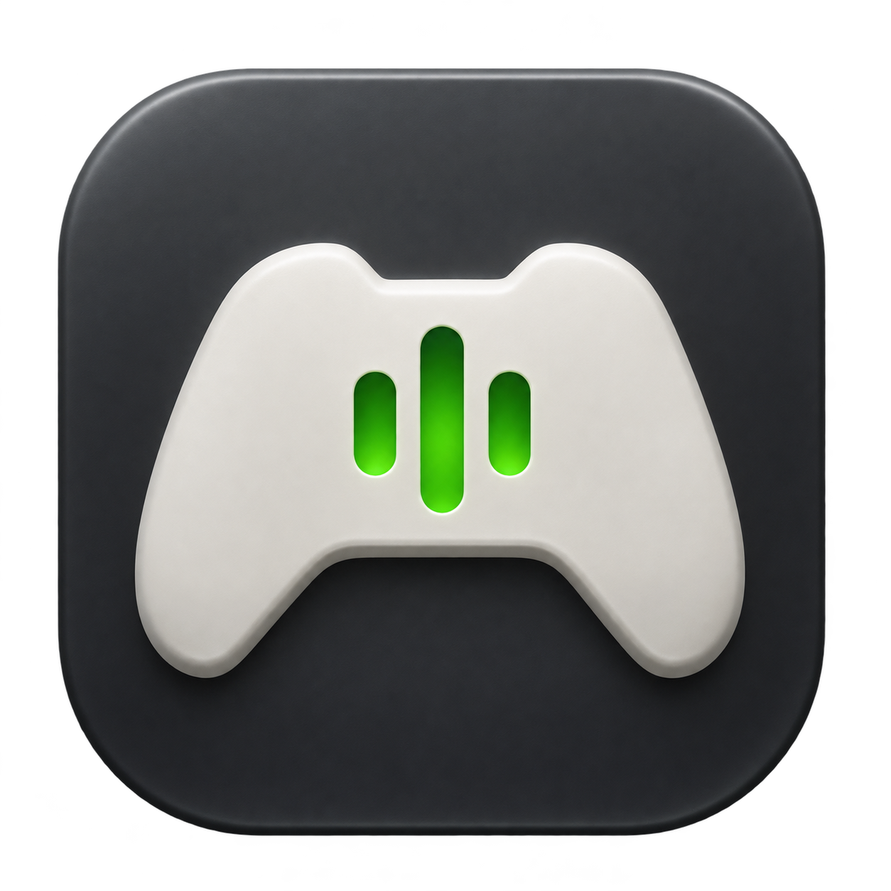

# JoyCode



用 Xbox 手柄在 macOS 上控制 AI Agent：切换应用、开始和结束听写、检查后提交草稿、切换会话。

JoyCode 使用 Swift、GameController 和 Accessibility，直接读取手柄输入，无需额外的键盘映射软件或 API Key。默认使用 Agent 原生听写，也可选择 Typeless。

## 当前状态

**0.3.16 Early Preview · build 28**。适配 ChatGPT／Codex 26.1111（内核由 Electron 改为 Chromium）的原生听写，修复转写后焦点离开导致的锁死；新增 Y 回答 Claude 选项卡和 Codex 提问面板的第一项（推荐项）；诊断事件写入 macOS 统一日志。

232 项测试及安装包构建、签名、SHA-256 校验通过。实机：Codex 主线 X 开始／X 结束／B 取消、Claude X／X／A 发送，以及 Y 回答 Claude 两按钮卡片和 Codex 计划提问均通过。远端构建与发布结果见 [Actions](https://github.com/wengych/JoyCode/actions)。

- **Codex 原生听写已在 26.1111 复测：**X 开始／X 结束、X 开始／B 取消通过；侧边对话不在支持范围。LB／RB 切换的完整轮次验收仍来自 0.3.12。
- **Codex 右摇杆滚动异常：**最新实体测试失败，尚未修复。
- **Codex A 提交尚未确认：**最新组合测试反馈只说明滚动失败，不能视为提交已通过。
- Claude 的语音和单次提交本版已复测；方向键和滚动只有早期版本成功记录，尚未完成当前版本全键复测。

详见 [更新记录](CHANGELOG.md) 和 [开发与验证历史](docs/DEVELOPMENT-HISTORY.md)。

## 环境与启动

需要 macOS 14 或更新版本、Xbox 手柄及支持的桌面客户端。目前主要在 Apple Silicon 上验证。

- Claude Desktop／Claude Code：`com.anthropic.claudefordesktop`。
- ChatGPT／Codex：当前适配的客户端 Bundle ID 为 `com.openai.codex`，不代表所有 ChatGPT 桌面或网页版均兼容。仅支持主线会话输入框，侧边对话（side chat）不在支持范围。
- 使用原生听写时，目标客户端须已有可用的听写入口。

1. 打开 `JoyCode.app`，连接手柄。应用初始处于诊断模式，仅显示最近输入。
2. 在系统设置 → 隐私与安全性 → 辅助功能（部分系统称“设备控制与数据访问”）中允许 JoyCode，以便聚焦输入框和操作目标控件。
3. 停止其他手柄映射软件；已有 InputConfig 用户可使用“退出 InputConfig 并接管手柄”。
4. 选择“Agent 原生听写”，点“启用遥控”，再点“隐藏此窗口”。
5. 用 LB／RB 切到目标应用，按 X 开始和结束听写，检查草稿后按 A 发送。完整用法见[操作说明](#操作说明)。

分发包使用本地 **ad-hoc 签名，未经 Apple notarization**，不是 Developer ID 签名的正式发行包。重新构建后可能需要刷新辅助功能授权。

## 操作说明

先用肩键切到目标应用：LB 切到 Claude，RB 切到 ChatGPT／Codex。其他键只作用于当前前台窗口，不会替你切换应用。

### 按键速查

| 键 | 作用 | 以下情况不操作 |
|---|---|---|
| **LB** | 切到 Claude 并聚焦输入框 | — |
| **RB** | 切到 ChatGPT／Codex 当前窗口，保留输入焦点 | — |
| **X** | 开始听写；再按一次结束。Codex 侧边对话有焦点时，改用主线输入框 | 前台不是 Claude 或 ChatGPT／Codex |
| **A** | 提交草稿一次，遵循当前 `Send`／`Queue`／`Steer` 模式 | 录音或转写中；草稿还在变化；1.5 秒内刚提交过。不会点 `Stop`／`Resume` 或权限审批 |
| **B** | 取消 JoyCode 发起、仍在录音的听写；状态不确定时用来复位 | 已进入转写阶段（需在 Agent 内取消） |
| **Y** | 回答选项卡的第一项（推荐项），每张卡只答一次 | 录音或转写中；输入框有草稿；Agent 仍在运行；审批或合并、归档、提交等操作按钮；多选题；需要输入文字的选项 |
| **方向键 ↑／↓** | 切换当前应用的会话 | Codex 混合侧栏中可能选到 Page 或附件 |
| **右摇杆 ↑／↓** | 滚动回复区，回中停止 | **Codex 当前异常**；滚动可能移动真实鼠标指针 |

主页键、系统菜单键和摇杆左右方向不绑定；暂不支持按住说话。

### 常用流程

**语音输入并发送**

1. 按 LB 或 RB 切到目标 Agent。
2. 按 X 开始说话，说完再按 X 结束。
3. 等转写完成、文字出现在输入框后检查草稿；不想发就在输入框里手动修改或删除。
4. 按 A 发送。

录音中按 B 可取消；进入转写阶段后，只能在 Agent 内手动取消。

**回答选项卡**

适用于 Claude Code 每轮结尾的“下一步”卡片，以及 ChatGPT／Codex Plan 模式（输入 `/plan` 打开）里的选择题。

- 选推荐项：按 Y。Claude 点带 ⌘↩ 的主选项；Codex 作答已选中的选项，没有选中时作答标着 Recommended 的选项。
- 选其他项：按 X 用语音回答，或手动点选。手柄不切换选项，因为 Claude 的卡片没有可见的选中状态。

Codex 提问面板若带唯一的 Submit／Continue／Next，Y 会先选中再提交；这条路径尚未实机验证。

**切换会话**

切到目标应用后按方向键 ↑／↓。Claude Code 使用会话菜单，Codex 使用侧栏的上一／下一项。

### 出问题时

| 现象 | 处理 |
|---|---|
| 按键没反应，菜单栏显示“仅诊断手柄输入” | 菜单栏点“显示遥控设置”，再点“启用遥控”。按钮是灰色的，说明还没有辅助功能授权 |
| 更新或重新构建后按键失效，日志出现“辅助功能权限：未授权” | 在系统设置的辅助功能列表里重新允许 JoyCode，回到设置窗口点“刷新”。开发时避免反复授权的方法见[构建与打包](#构建与打包) |
| 提示“InputConfig 仍在运行” | 在设置窗口点“退出 InputConfig 并接管手柄” |
| 转写中按 B，提示“正在转写，暂不支持 B 取消” | 在 Agent 内取消；JoyCode 会继续核验结束状态 |
| 提示“文字已出现，但输入焦点已离开输入框” | 点回输入框检查草稿，再按 A |
| 提示“未确认听写完成”，或 LB／RB 提示“锁定保留” | 先在 Agent 里确认录音和转写都已停止，再按 B：JoyCode 先自动核验，核验不了会提示确认，再按一次 B 复位。也可以在设置窗口点“我已手动停止听写，复位状态…”。复位不会替你停止 Agent 的录音 |
| 按 A 或 Y 提示“刚提交过”或“刚触发” | 1.5 秒内防重复提交；先看 Agent 是否已收到 |
| 其他失败 | 运行 `bash logs.sh errors` 查看最近一天的失败原因，见[诊断日志](#诊断日志) |

### 安全约束

普通动作捕获当前应用、进程和窗口，并在执行时复核。切窗或目标不明会停止操作；只有肩键和明确的激活入口能主动切换窗口。录音／转写期间锁定目标；状态不明时，仅在原窗口只读确认空闲后恢复，不会自动重录或发送。原目标无法恢复时，肩键仍会把所属应用切回前台但保留锁定。

同一目标、同一草稿的提交尝试会保留记录，防止结果未知时重复提交；切到其他 Agent 不会清除记录，观察到同一编辑器内容改变或清空后才释放。客户端更新可能改变可访问性结构，遇到未知控件时应用会拒绝操作。

## 手柄电量

菜单栏保持单个 18 pt 手柄图标，在同一图标底部以 16 × 2 pt 进度线表示有效电量，不增加第二个电池图标或菜单栏宽度。电量未知或手柄断连时维持原手柄图标，无问号。详细电量、充电状态及低电量提示放在菜单文字和设置窗口；低电量条件仍为不高于 20%、未充电且非已充满状态。

原生 GameController 每 30 秒刷新，有效读数优先；原生读数未知时，每 60 秒在后台读取蓝牙系统报告。仅当 GameController 和蓝牙报告均能唯一匹配已连接的 Xbox 手柄时采用后备读数，失败或有歧义仍显示未知。暂停遥控后也会刷新，菜单会区分读数来源。

未知不会被当作 0%，但蓝牙报告明确提供的有效 0% 可以显示。百分比是系统／手柄上报的估计值；100% 不用于推断正在充电。0.3.15 实机已显示蓝牙来源的约 100%，充电状态仍为未知；没有验收真实充电变化。菜单栏单槽布局经过代码和样图验证，实机界面检查覆盖的是设置页使用的同一图标组件，不是菜单栏截图验收。

## Typeless（可选）

可设置全局语音来源及按应用覆盖。选择 Typeless 后需保持其运行，并把 JoyCode 快捷键设为与 Typeless 一致；初始值为左 Option + 反引号。支持录制左右修饰键和 Fn，保存设置只修改 JoyCode。

录音开始时固定后端和快捷键，中途不会自动回退。Typeless 浮层若夺取前台，需手动返回原 Agent 窗口再操作；取消后可能需要再次 B 确认复位。

## 构建与打包

需要 Xcode／Swift 工具链，无第三方 Swift 包依赖。在仓库根目录运行：

```bash
bash test.sh
bash build.sh
open "dist/JoyCode.app"
```

生成发布压缩包和校验文件：

```bash
bash package-release.sh
(cd dist && shasum -a 256 -c SHA256SUMS)
```

打包脚本会重新构建；默认输出 `dist/JoyCode-0.3.16-build28-macos-arm64.zip` 和 `dist/SHA256SUMS`，架构名按实际二进制确定。构建缓存位于 `.build-work/`。可通过 `JOYCODE_BUILD_ROOT`、`JOYCODE_DIST_DIR` 等环境变量覆盖路径，相对值均按仓库根目录解析；完整选项见 [script-env.sh](script-env.sh)。

默认使用 ad-hoc 签名，每次重新构建后系统都会把它当作新应用，辅助功能授权随之失效。本机开发时，可在“钥匙串访问 → 证书助理 → 创建证书”中建一张自签名的“代码签名”证书，并在其信任设置中将“代码签名”设为“始终信任”，然后用它签名；首次授权后，重新构建不再需要重新授权：

```bash
JOYCODE_SIGN_IDENTITY="证书名称" bash build.sh
```

图标源文件为 [Resources/AppIcon-master.png](Resources/AppIcon-master.png)。修改后运行 `bash make-icon.sh` 更新 ICNS；正常构建保留已有图标。

### 诊断日志

设置窗口“最近事件”中的内容、手柄按键（含未启用遥控时的“仅诊断”按键）、启动信息和辅助功能权限变化都会写入 macOS 统一日志，可在终端查看：

```bash
bash logs.sh          # 最近 30 分钟
bash logs.sh stream   # 实时跟随，边按键边看
bash logs.sh errors   # 最近 1 天弹出过提示的失败
```

带 HUD 的失败为 error 级别，其余为 notice。ad-hoc 重新构建后辅助功能授权可能失效，日志会出现“辅助功能权限：未授权”。

## 本地数据与代码

为兼容早期配置，Bundle ID／UserDefaults 域保持 `local.weng.XboxAgentRemote`，内部可执行文件名保持 `XboxAgentRemote`。配置保存在本机，草稿备份只保留在内存中。

JoyCode 不采集或上传语音；语音由所选 Agent 或 Typeless 处理。诊断记录动作与窗口身份等元数据，不记录草稿、转写或录音内容；同一份事件和手柄输入也写入本机 macOS 统一日志（subsystem `local.weng.XboxAgentRemote`，可能包含自行登记的会话名称），不上传。快捷键录制仅在设置窗口获得焦点时工作。

- [Sources/XboxAgentRemote](Sources/XboxAgentRemote)：应用界面、手柄输入、协调器与 Accessibility 适配。
- [Sources/RemoteCore](Sources/RemoteCore)：状态、目标约束、控件语义与滚动计算。
- [Tests/RemoteCoreTests](Tests/RemoteCoreTests)：核心回归测试。
